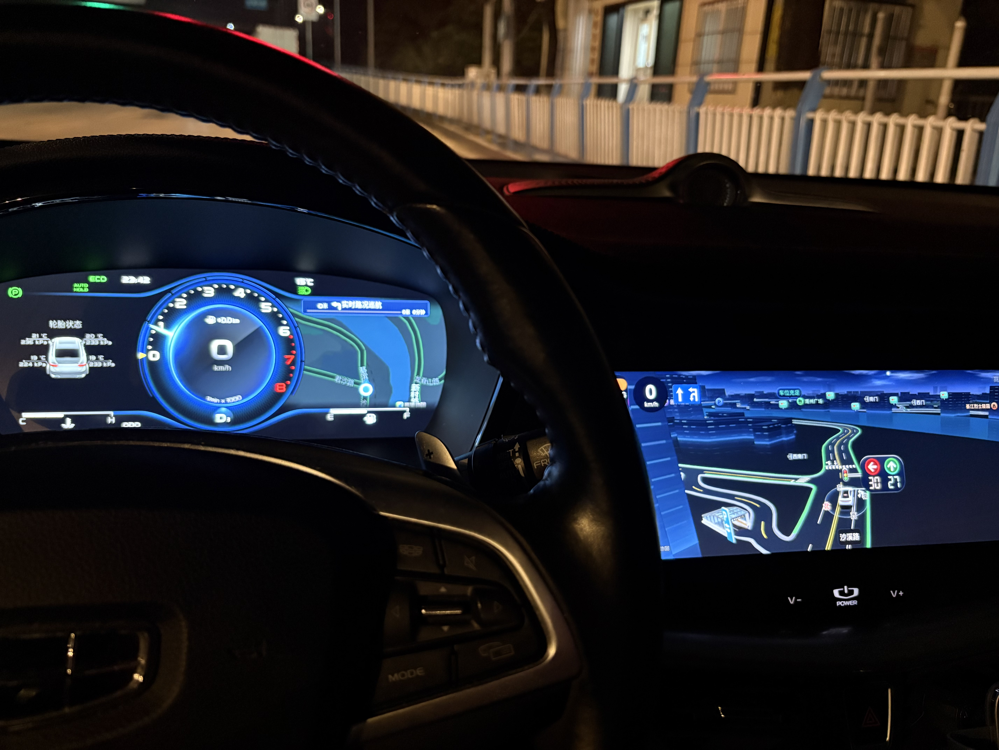

# geely-kc2-diplay-cluster-map

在**吉利博瑞 GE 2020 款 1.5T 耀尊**（车机平台 H52 / KC2，Neusoft·ECARX，Android 4.3）上，把 **CarPlay 的仪表盘地图** 显示到车机仪表屏的实验性实现。

原车高德可以通过 CarPlay 在仪表盘显示地图；本项目让第三方 CarPlay 中转方案获得同样能力。

> **兼容性**：已在吉利博瑞 GE 2020 款 1.5T 耀尊实车验证；2018–2020 款搭载 GKUI 车机的吉利车型理论上可用，详见下方[兼容性](#兼容性)一节。

本项目**基于 [DiPlay · 吉利 GKUI 1.2 / Android 4.3](https://github.com/xikai6282/DiPlay-Geely-Android43) 二次开发**，在其 CarPlay 中转能力之上，新增仪表盘地图的渲染与路线状态联动。DiPlay 本身基于 [shihabal3amri/DiPlay](https://github.com/shihabal3amri/DiPlay) v0.2.10 适配而来。

> 本仓库只包含**增量改动**：新增类、JNI 渲染层、smali hook 与构建/测试脚本。上游 DiPlay 的完整源码、APK 与构建产物不在此仓库内，请从上游仓库获取对应版本（C7A-R2）后按本文档打补丁。

## 原理

1. 中转 App（DiPlay）向手机申请第二路 CarPlay 显示（stream type `111`，`maps:/car/instrumentcluster/map`）；
2. 解码输出交给 `SurfaceTexture`，由新增的 `GeelyClusterMap` 类接管；
3. 一个小的 JNI 库通过车机自带的 `/system/lib/libexternalsurfacehelper.so` 拿到仪表 surface，用 EGL/GLES2 把帧画上去；
4. 车机的 `screencap_neu` 只在有帧交换时推流，所以 `GeelyClusterMap` 在路线激活期间以固定帧率重绘最新帧，路线结束后停止，仪表约 1 秒内回落到原状态栏；
5. `CarPlayHostActivity` 里三处 smali hook 把原有的（BYD 专用）仪表通路改指向 `GeelyClusterMap`，`H52NavigationBridge` 中一处 hook 负责上报路线开始 / 结束。

## 实际效果

*巡航模式实拍：左侧**仪表**是二维巡航图，没有红绿灯倒计时和红黄绿路况；右侧**中控**是近景地图，可见信号灯倒计时数字。*

[▶ 实车演示视频](docs/media/demo.mp4)（MP4，约 7 MB，点击播放）

### 两个屏幕的分工（现状）

| 模式 | 仪表屏 | 中控屏 |
| --- | --- | --- |
| **巡航**（未开始导航） | 二维巡航图，**没有**路况色块和红绿灯倒计时 | 近景地图，**有**路况与红绿灯倒计时 |
| **导航中** | 近景导航图，**有**路况信息 | **只显示导航总览** |

这正是目前最需要改进的地方 —— 它和原车高德的分工基本相反：

- 巡航时最有用的信息（红灯还剩几秒、前方堵不堵）留在中控，开车时低头看中控并不方便；
- 导航时仪表已经有路况了，中控却只剩一个总览。

这个分工来自**高德地图自身的双屏策略**，不是本项目的代码缺陷：CarPlay 投到仪表的内容由导航 App 决定，投屏方案只能如实转发，无法凭空补出 App 没有送过来的数据。

多位车主在其他车型上的对比复测结论一致：

| | 巡航模式 | 导航模式 |
| --- | --- | --- |
| **百度地图** | 中控与仪表**都显示**红绿灯读秒 | 两屏可显示**相同**画面 |
| **高德地图** | 只有中控显示读秒，仪表不显示 | 必须一屏导航视角、一屏全览，不能两屏同图 |

所以想让巡航时的仪表也看到红绿灯倒计时，目前只有两条路：

1. **改用百度地图**导航 —— 它本来就把读秒同时送到两块屏，不需要本项目额外处理；
2. **把中控画面镜像到仪表** —— 需要额外的解码器与绘制开销，正在评估可行性，暂不承诺时间。

本项目不会用估算值伪造灯号或路况：数据只能来自手机导航 App 本身。

## 目录

| 路径 | 说明 |
| --- | --- |
| `h52-cluster-map/java/` | `GeelyClusterMap` 及配套 Java 源码 |
| `h52-cluster-map/native/` | JNI 渲染层（C，NDK r21e，`armv7a-linux-androideabi18`） |
| `h52-cluster-map/checkpoints/` | 各阶段可回退的代码快照与就地运行的脚本 |
| `h52-cluster-map/tests/` | 巡航 / 路线结束策略的单元测试 |
| `h52-cluster-map/*.md` | 构建说明（R7）与巡航模式设计 |
| `hud-probe/` | 仪表 surface 探测工具与抓取到的运行日志 |
| `docs/` | 实施计划与背景记录 |

## 构建

见 [`h52-cluster-map/R7_QUICKSTART.md`](h52-cluster-map/R7_QUICKSTART.md) 与 [`BUILD_R7.md`](h52-cluster-map/BUILD_R7.md)。工具链为 C（NDK r21e）、Java 7、smali/baksmali 3.0.9、Android build-tools 34，构建脚本为 Python 3 + `adb`。

构建前需先从上游取得对应版本（C7A-R2）的 APK 或源码归档，解包出 smali 树作为基线，再把本仓库的增量打上去 —— 反编译出的完整类树（`android_tree/`）未纳入版本控制。

> 仓库**不包含**：厂商固件包、任何 APK 成品、反编译出的完整类树、Root 工具，以及上游 DiPlay 的源码副本。这些需自行从设备、上游仓库或官方渠道获取。

## 兼容性

| 状态 | 车型 / 车机 |
| --- | --- |
| ✅ **已实车验证** | 吉利博瑞 GE 2020 款 1.5T 耀尊 — H52 / KC2 车机，GKUI（Android 4.3），固件 `kc_update_01.03.12000.H52.00016` |
| ⚠️ **理论可用，未验证** | 2018–2020 款 吉利博瑞 / 缤越 / 缤瑞 / 嘉际 / 星越 等搭载 GKUI 车机（Android 4.3）的车型 |
| ❌ **不支持** | E01 车机（上游 DiPlay 已明确） |

需要区分两层能力，通用性并不相同：

- **DiPlay 本体**（无线 CarPlay 连接、画面、触控、音频）在这些 GKUI 车机上通用性较好，属于上游项目已验证的范围；
- **本项目的仪表盘地图注入**依赖各车型仪表自身的 surface 通路（`libexternalsurfacehelper.so`）与仪表类型。缤越、缤瑞、嘉际、星越的仪表形态和中控软件与本车不同，**未验证前不要假设可用**。

因此，把包装到其他车型上属于**自行测试**：装得上、中控 CarPlay 正常，不代表仪表一定能出图。测试结果欢迎反馈，请按 [Issue 模板](https://github.com/tinystar113/geely-kc2-diplay-cluster-map/issues/new?template=test-report.yml) 提交车型、年款、配置、车机固件号与现象，我会汇总到这个表格里。

## 安装

> 本节针对**构建好的发布包**。本仓库为源码增量，不含安装包，需自行构建。

1. 使用前先打开车机的**调试模式**。
2. 把发布包内的全部文件复制到 **FAT32** 格式的 U 盘根目录（不要套一层文件夹）。
3. 插到点烟器旁边的 USB 接口，车机会自动安装。
4. 若车机不识别 U 盘，长按中控屏下方的 **1 号键** 数秒，车机自动重启后重试。

发布包已内置禁用自带高德地图（`com.autonavi.amapauto`）的脚本，无需 root 车机，也不需要额外操作。安装内容为应用层改动，不刷写系统分区；主要风险是安装不成功，不涉及行车安全，对系统稳定性影响有限。

## 已知问题

**导航时仪表盘路名轻微跳动**

车机自带高德会在后台以约每秒 1 次的频率向仪表盘发送路名广播，与 DiPlay 的广播冲突，导致仪表状态栏的路名在「当前道路」与「下一条道路」之间来回跳动（只是文字跳变，不是屏幕闪烁）。车辆静止时（如等红灯）症状消失，重新行驶后复现。

自带高德是系统预装、开机自启，不 root 无法禁用。当前版本已针对该冲突做过优化，在约 0.06 秒内覆盖高德的广播，跳动明显减轻，但仍肉眼可见。

彻底解决需要 root 车机后禁用自带高德（`com.autonavi.amapauto`）。

## 来源与许可

| 层级 | 项目 | 许可 |
| --- | --- | --- |
| 上游 | [shihabal3amri/DiPlay](https://github.com/shihabal3amri/DiPlay) v0.2.10 | GPL-3.0 |
| 直接基础 | [xikai6282/DiPlay-Geely-Android43](https://github.com/xikai6282/DiPlay-Geely-Android43)（C7A-R2） | GPL-3.0 |
| 本仓库 | 仪表盘地图注入增量改动 | GPL-3.0 |

本仓库基于 **[@xikai6282](https://github.com/xikai6282) 的 [DiPlay-Geely-Android43](https://github.com/xikai6282/DiPlay-Geely-Android43)** 开发，感谢原作者对吉利 GKUI 1.2 / Android 4.3 车机 CarPlay 适配的持续维护。上游的免 root 桥接、无线连接、音频与硬解基线是本项目得以运行的前提。

由于上游以 GPL-3.0 发布，本仓库作为衍生作品同样遵循 **GPL-3.0**，完整许可文本见 [LICENSE](LICENSE)；修改与再分发请一并保留上游署名与许可声明。

补充说明：

- 本项目与 Apple、吉利汽车、亿咖通（ECARX）、东软（Neusoft）均无隶属关系。
- CarPlay 是 Apple Inc. 的商标；本项目不是 Apple 认证产品，未使用 Apple 的认证资产。
- 上游项目明确不支持 E01 车机；本项目在**吉利博瑞 GE 2020 款 1.5T 耀尊（H52 / KC2，固件 `kc_update_01.03.12000.H52.00016`）** 上实车验证，未覆盖其他车型或车机。同平台车型可参考，但仪表通路、原厂固件版本存在差异，需自行测试。
- 仓库内**不包含**任何厂商固件、上游 APK 或 Apple 私有资产。

## 开发方式

本项目的作者**没有编程背景**，不熟悉 Java、C 或 Android 的常规工程实践。

全部代码、脚本与文档均由作者与 AI 大模型协作产出，主要使用 Claude、ChatGPT、DeepSeek 的对话式编程（vibe coding）：作者描述目标与实车现象，模型给出实现，作者在车上反复实测，再据此迭代。

这意味着几件事，请在参考本项目前知悉：

- 代码很可能不符合常规工程规范 —— 风格不统一、缺少系统化测试、也没有为长期维护做抽象；
- 所有结论**以实车测试结果为准**，而非以代码审阅为准；
- 能跑通不等于实现方式最优或最安全。

如果你有 Android 或车载开发经验，欢迎指出问题、提 PR 或直接改 —— 尤其是 smali hook 与 EGL 渲染这两部分，是我最没有把握、风险也最高的地方。

## 免责声明

本项目仅用于**自己车辆**上的个人研究与学习。修改车机系统可能影响保修、稳定性与行车安全，所有操作风险自负。请遵守当地法律法规，不要分发他人受版权保护的固件或软件。
